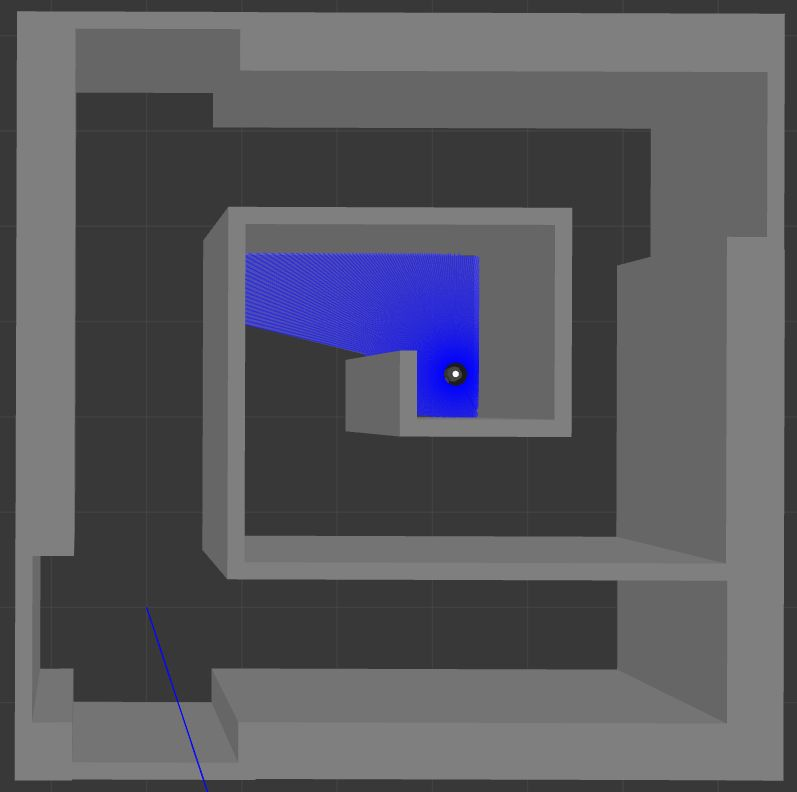
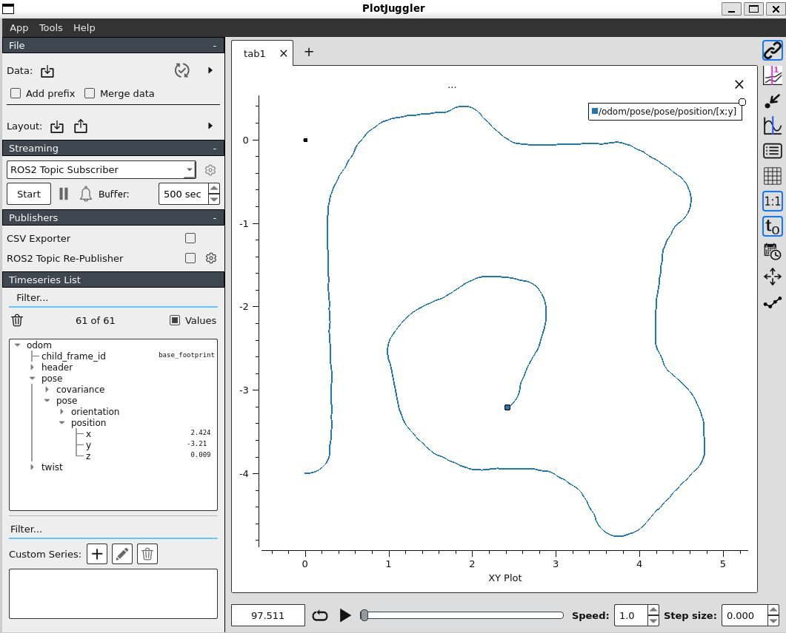
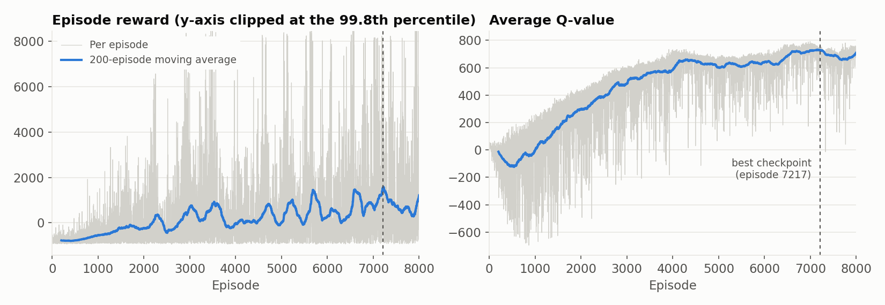
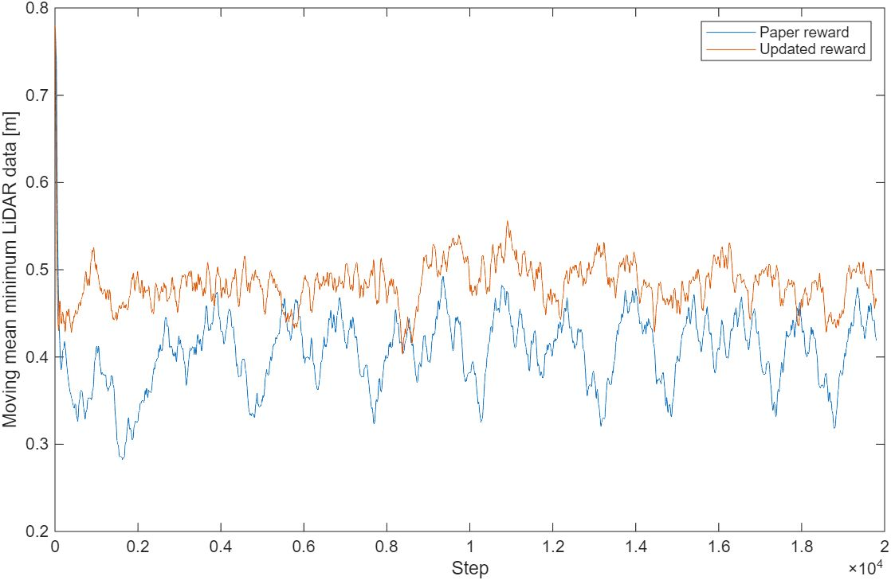
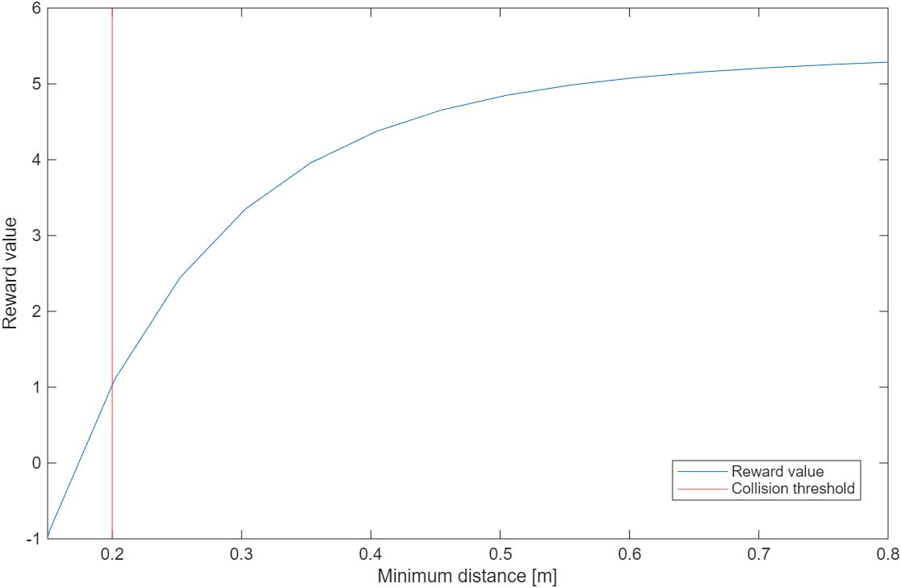
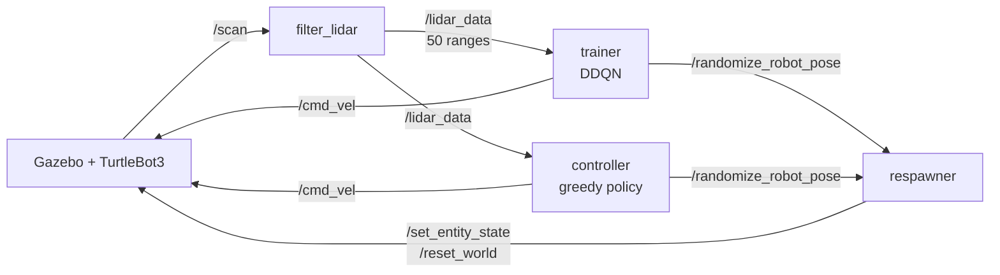

# DRL Obstacle Avoidance for TurtleBot3

Deep Reinforcement Learning (Double DQN) controller that teaches a TurtleBot3 to navigate narrow, cluttered environments using only LiDAR, built with **ROS 2 Humble**, **Gazebo** and **TensorFlow**.

The project re-implements and extends the method of
[Feng, Sebastian & Ben-Tzvi, *"A Collision Avoidance Method Based on Deep Reinforcement Learning"*, Robotics 2021](https://doi.org/10.3390/robotics10020073):
instead of reacting only to obstacles inside a fixed trigger distance (as potential-field or DWA planners do), the agent uses the **whole LiDAR range** to infer the shape of the environment and pick the correct way out of corridors and dead ends.

> Developed for the Robotics course at Politecnico di Torino. The robot here is a TurtleBot3 Burger simulated in Gazebo, while the paper uses the STORM tracked platform.

<p align="center">
  
  
</p>
<p align="center"><em>Navigation through a map not used for training: top view in Gazebo (left) and recorded odometry (right).</em></p>

## Highlights

- **End-to-end DDQN agent** in ROS 2: LiDAR in, velocity commands out, with no map or global planner.
- **Built on the paper's formulation**: same state space (50 LiDAR beams), action space (11 angular velocities), network (2 × 300 ReLU), loss (Eq. 5) and DDQN target (Eq. 6).
- **Engineering on top of the paper:**
  - Shaped reward: exponential proximity penalty plus a linear clearance bonus, calibrated on the corridor widths of the training map.
  - Gradient steps run on a background thread, so training does not block the ROS callback loop.
  - Best-model checkpointing on the smoothed episode reward, early stopping, and crash-safe resumable checkpoints.
- **Automated episode reset**: a respawner node parses the Gazebo world/mesh geometry, precomputes collision-free poses, and teleports the robot with a heading that guarantees forward clearance.
- **Reproducible evaluation**: the test controller logs every step (min distance, action, ω) to CSV and counts collisions over a fixed 10-minute run.

## Results

The published model is [`models/best_model.keras`](models/best_model.keras): the checkpoint with the best 200-episode average reward (1589, at episode 7217) out of an 8000-episode run.



### Reward shaping

The paper's reward is constant while the robot survives, so nothing discourages it from driving close to walls. The shaped reward keeps it further away. In a 10-minute run (19800 steps) on the training map, the published model compared with a paper-like baseline as follows:

| Model | Collisions | Mean minimum LiDAR distance |
|---|---|---|
| Paper-like baseline | 3 | 0.405 m |
| Shaped reward (published model) | 2 | 0.483 m |

These are single runs, so they are indicative rather than statistically significant.

| | |
|---|---|
|  |  |
| *Moving mean of the minimum LiDAR distance in the two runs above* | *Reward as a function of the distance to the nearest obstacle* |

### Map not used for training

<!-- UNSEEN_MAP_RESULTS -->

## Method

| | |
|---|---|
| **State** | 50 LiDAR ranges, clipped to 5 m and normalised to [0, 1] |
| **Actions** | 11 discrete angular velocities, ω<sub>m</sub> = −0.8 + 0.16·m rad/s, at constant v = 0.2 m/s |
| **Network** | MLP 50 → 300 → 300 → 11 (ReLU), Adam, lr = 1e-3 |
| **Algorithm** | Double DQN, replay buffer 100k, batch 256, γ = 0.99, hard target update every 1000 env steps |
| **Exploration** | ε-greedy, ε<sub>k+1</sub> = 0.9996·ε<sub>k</sub> per episode, ε<sub>min</sub> = 0.05 |
| **Reward** | +5 per step, −1000 on collision (< 0.2 m), −20·e<sup>−4d/0.1</sup> when d < 0.1, +2·d clearance bonus, where d is the minimum range normalised to [0, 1] (d = 0.1 is 0.5 m) |

DDQN target: the online network selects the next action and the target network evaluates it,
y = r + γ · Q<sub>θ⁻</sub>(s′, argmax<sub>a</sub> Q<sub>θ</sub>(s′, a)).

## Architecture



| Node | Role |
|---|---|
| `filter_lidar` | Cleans NaN/Inf, clips to max range, downsamples the scan to 50 beams |
| `trainer` | DDQN training loop: reward, replay buffer, ε-greedy, checkpoints, CSV log |
| `controller` | Runs a trained model greedily and logs test metrics |
| `respawner` | Service that resets the robot to a random collision-free pose |

## Repository structure

```
.
├── models/
│   └── best_model.keras        # trained Q-network
├── media/                      # figures used in this README
├── requirements.txt            # Python dependencies (pip)
└── src/oa_drl_control/
    ├── launch/
    │   ├── training.launch.py  # headless Gazebo + filter + respawner (training)
    │   └── testing.launch.py   # Gazebo + filter + respawner (evaluation)
    ├── oa_drl_control/
    │   ├── trainer.py
    │   ├── controller.py
    │   ├── lidar_data_filter.py
    │   └── respawner.py
    └── worlds/
        ├── training_env.world  # training map (mesh: training_env.obj)
        ├── test_env.world      # same mesh, real-time physics
        └── unseen_env.world    # different map, not used for training
```

## Getting started

### Requirements

- Ubuntu 22.04, ROS 2 Humble, Gazebo Classic 11
- Python 3.10
- TurtleBot3 simulation packages

### Installation

The repository is meant to be cloned as a colcon workspace (`~/ros_ws`):

```bash
git clone https://github.com/ssebba/DRL-Obstacle-avoidance.git ~/ros_ws
cd ~/ros_ws
git clone https://github.com/SESASR-Course/turtlebot3_simulations.git src/turtlebot3_simulations

python3 -m venv .venv
source .venv/bin/activate
pip install -r requirements.txt

colcon build --symlink-install
source install/setup.bash
```

Add the following to `.venv/bin/activate` so that the virtual environment can see the ROS Python packages:

```bash
export PYTHONPATH=$PYTHONPATH:/opt/ros/humble/lib/python3.10/site-packages
export PYTHONPATH="$VIRTUAL_ENV/lib/python3.10/site-packages:$PYTHONPATH"
export PROTOCOL_BUFFERS_PYTHON_IMPLEMENTATION=python
```

Suggested `~/.bashrc`:

```bash
source /opt/ros/humble/setup.bash
source /usr/share/gazebo/setup.bash
source ~/ros_ws/.venv/bin/activate
source ~/ros_ws/install/setup.bash
export TURTLEBOT3_MODEL=burger
export ROS_DOMAIN_ID=10
export ROS_LOCALHOST_ONLY=1
```

### Training

```bash
# Terminal 1: simulation, LiDAR filter and respawner
ros2 launch oa_drl_control training.launch.py

# Terminal 2: DDQN trainer
ros2 run oa_drl_control trainer
```

Checkpoints, `best_model.keras` and `training_log.csv` are written to `~/ros_ws/models`, which **overwrites the published model** when the repository is cloned as `~/ros_ws`. Set `OA_DRL_MODELS_DIR` to use a different folder for both `trainer` and `respawner`. Training resumes automatically from the last checkpoint. Hyperparameters are grouped at the top of [`trainer.py`](src/oa_drl_control/oa_drl_control/trainer.py).

### Testing the trained model

```bash
# Terminal 1: map with the same geometry as training
ros2 launch oa_drl_control testing.launch.py

# Or: the map not used for training
ros2 launch oa_drl_control testing.launch.py world_file:=unseen_env.world x_pose:=0.0 y_pose:=-4.0

# Terminal 2: greedy controller
ros2 run oa_drl_control controller
```

The launch file also starts the respawner, so the robot restarts from a random free pose after a collision. Add `gui:=false` to run without the Gazebo client. Each run lasts 19800 steps, which is 10 minutes of simulated time at the 33 Hz LiDAR rate. It writes a CSV log to `~/ros_ws/logs` (parameter `log_dir`) and prints the collision count at the end. Use the `model_path` parameter to test another model.

## Reference

```bibtex
@article{feng2021collision,
  title   = {A Collision Avoidance Method Based on Deep Reinforcement Learning},
  author  = {Feng, Shumin and Sebastian, Bijo and Ben-Tzvi, Pinhas},
  journal = {Robotics},
  volume  = {10},
  number  = {2},
  pages   = {73},
  year    = {2021},
  doi     = {10.3390/robotics10020073}
}
```

## Author

**Sebastiano Comai**, sebastiano.comai@outlook.it

## License

[Apache-2.0](LICENSE)
